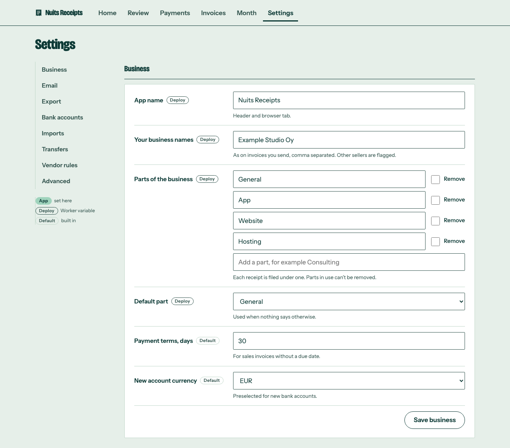

Use this guide to change most of the app's settings from **Settings**, without editing a config file or deploying. A value saved in the app is stored in your D1 database and wins over the Worker variable of the same name: app setting, then Worker variable, then the built-in default.

## Prerequisites

- You can sign in to the app.
- For the email fields: access to Cloudflare Email Routing, because the app cannot create or check routing rules.

## What you can change here

| Section | Fields |
| --- | --- |
| **Business** | App name, Your business names, Parts of the business, Default part, Payment terms (days), New account currency, and **Vendor rules** |
| **Email** | Receipt address, Invoice address, Forward a copy to, and **Email senders**: allowed senders (**Add** or **Remove**, no tick needed), ignored senders (**Stop ignoring**) and **Mail we didn't keep** |
| **Bank** | Bank accounts |
| **Sending** | Accountant, Export file name, Note under the month download, and OneDrive when it is set up |
| **Advanced** | **Review & matching** (the review and matching thresholds), **Integrations** (source code link), **Set when deployed**, **Change history**, **Search** and **About** |

Sign-in (Access settings, the password user name and the password), the base path, the reader mode, the OneDrive app and its secrets stay deploy-time. They are listed read-only under **Advanced > Set when deployed**, with secrets shown only as "Set" or "Not set". For every variable and where it can be changed, see [Configuration](/reference/configuration/).

## Change a setting

<Steps>
  <Step title="Open the section">

Open **Settings** and open the section. There are five sections, **Business**, **Email**, **Bank**, **Sending** and **Advanced**. Every section starts closed, with a one-line summary such as "receipts@example.com, 2 allowed" for **Email**. A link to a section, such as `/settings#email`, opens it.

  </Step>
  <Step title="Edit the field">

Each field is a label and an input. Hover over the input (or long-press it on a phone) to see its help. The line under it says where the value comes from: **Set in the app**, **Set when deployed** or **Built-in default**.

For **Parts of the business**, rename a part in place, tick **Remove** to drop one, or type a new one in "Add a part". A part used by any receipt or vendor rule can be renamed but not removed.

  </Step>
  <Step title="Tick the confirmation, if there is one">

**Receipt address**, **Invoice address** and **Forward a copy to** each show a tick box once you change them, for example "I’ve added the Email Routing rule for this address". It must be ticked in the same save.

  </Step>
  <Step title="Save">

Press **Save** at the bottom of the page. One **Save** covers every section. You come back with the same section open. Values are checked with the same rules as the Worker variables; an invalid value is refused with the reason.

  </Step>
  <Step title="Finish email changes in Cloudflare">

After changing the receipt or invoice address, the app shows "Saved. Now update Cloudflare Email Routing." with a short checklist. Add a **Send to a Worker** rule for the new address, send a test from an allowed address, then remove the rule for the old one. See [Set up email](/how-to/set-up-email/).

  </Step>
</Steps>

## Check it worked

- The banner at the top says what was saved, such as "Saved your email settings." ("Saved your settings." when the save touched more than one section), and **Reset** now shows next to the field. A save that removed a part offers **Undo**, which puts the whole save back.
- **Advanced > Change history** lists the change with the old and new value. Saves are recorded under your Access email, or `password` with password sign-in.

## Go back to the deploy value

Press **Reset** next to the field. This deletes the app value, so the Worker variable (or the default) applies again. The banner says, for example, "Payment terms, days is back to the value set when deployed." or "... is back to the built-in default." Resets are also kept in the change history.

Saving a value equal to the deploy value has the same effect: no app value is kept.

## Things to know

- **A later deploy does not override an app value.** If you change a Worker variable and deploy while an app value exists, the app value still wins. Press **Reset** to use the deploy value.
- **Row buttons do not save the form.** **Remove** on a sender, **Rename** on a bank account and the vendor rule buttons act at once and reload the page. Save typed changes first, or they are lost.
- **Two tabs.** If someone saved in another tab since you opened the page, your save is refused with "Settings were changed in another tab or by someone else. Reload and try again."
- **A saved value that stops being valid** (for example after a deploy changes another setting it depends on) is ignored with a warning on the field, and the deploy value or default is used. Press **Clear it** to remove it.
- **Changing the invoice address.** Mail to the old address still counts as an invoice for 30 days.
- **Changing a matching threshold** or the payment terms re-runs matching straight away, so waiting payments may be paired.

## Related

- [Configuration](/reference/configuration/) lists every setting, its variable and its default.
- [Deploy from the command line](/how-to/deploy-from-the-command-line/) for the deploy-time settings.
- [How matching works](/explanation/how-matching-works/) and [How reading works](/explanation/how-reading-works/) explain what the thresholds change.
