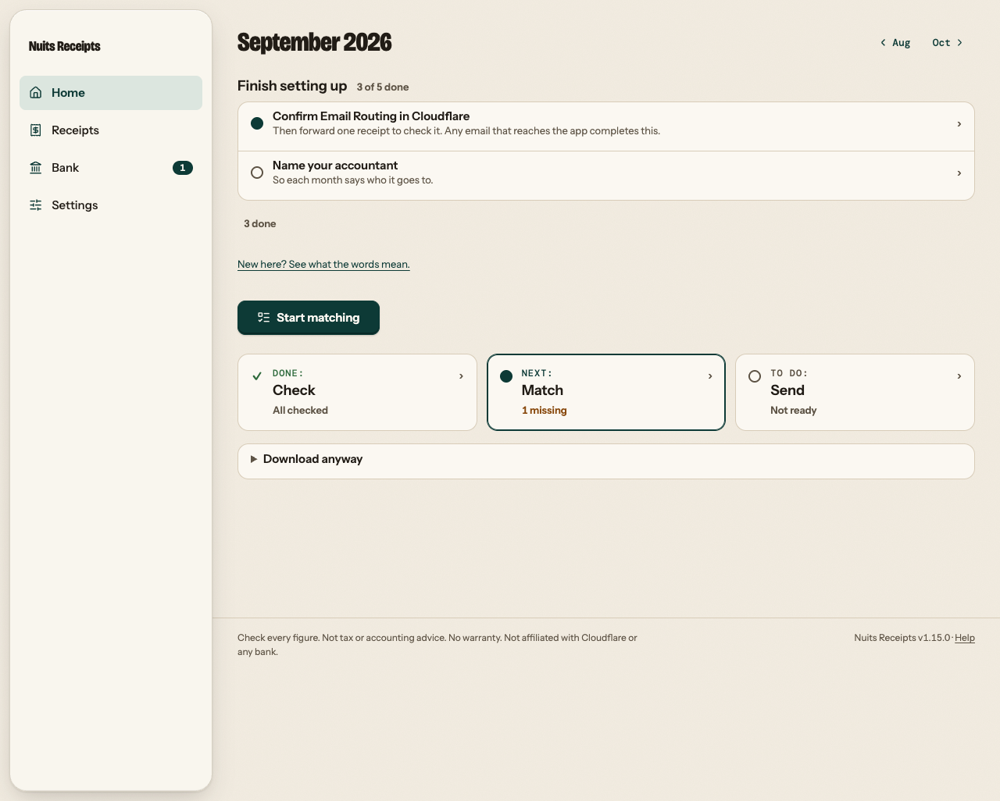

Nuits Receipts is a receipt inbox that runs on Cloudflare Workers. You deploy your own copy into your own Cloudflare account, and Nuits never sees your data.

Each month it helps you get organised before you hand things to your accountant:

- It reads the seller, amounts, VAT and dates from the receipts you upload or forward by email, and flags anything it is unsure of.
- It imports your bank's CSV export (you map the columns once) matches the sure pairs for you, and shows likely ones side by side for you to confirm.
- It shows the payments that have no receipt yet.
- It prepares a ZIP of the month's originals with an index spreadsheet, or just a CSV, for you to send to your accountant.

Afterwards, every receipt and invoice is found in seconds. **Home** keeps every finance document (receipts, sales invoices, bank statements, other finance documents and the months you sent) in folders that build themselves, searchable by their details and by the words inside PDFs, and opens them in the app's own PDF viewer. See [Find any document](/how-to/find-any-document/).

:::note[What it is not]
Nuits Receipts organises receipts and prepares files for your accountant. It is not tax, VAT or accounting advice, and it is not a bookkeeping system. Figures are read by AI and you check them. Your accountant decides how things are booked. Keep originals as your local law requires. Nuits Receipts keeps a copy in your own Cloudflare R2 bucket.
:::

## Where to start

<CardGrid>
  <Card title="Deploy your own copy" href="/tutorials/deploy-your-own-copy/">Put the app in your Cloudflare account and sign in for the first time.</Card>
  <Card title="Your first month" href="/tutorials/your-first-month/">Upload a receipt, import a bank statement and send the month, with sample files.</Card>
  <Card title="Run it locally" href="/tutorials/run-it-locally/">For contributors: run the app and the tests on your own machine.</Card>
</CardGrid>

## Find your way around

The docs are split into four kinds of page. Pick the one that fits what you are doing now.

<CardGrid>
  <Card title="Tutorials" href="/tutorials/">Lessons for your first time. Follow them from top to bottom and you end up with something working.</Card>
  <Card title="How-to guides" href="/how-to/">Recipes for one task each: set up email, import a bank CSV, send the month, upgrade.</Card>
  <Card title="Reference" href="/reference/">Facts to look up: every setting, command, export column, review flag and limit.</Card>
  <Card title="Explanation" href="/explanation/">Background: how reading and matching work, what the app checks, privacy and running costs.</Card>
</CardGrid>

## Who these docs are for

- **You run your own copy.** Start with the tutorials, then keep the how-to guides for the monthly routine and the reference for settings.
- **You change the code.** Start with [Run it locally](/tutorials/run-it-locally/), then read [How it works](/explanation/how-it-works/) and [Run the tests](/how-to/run-the-tests/).
- **You receive the month's files as an accountant.** Read [For accountants](/explanation/for-accountants/) to see how the figures were produced, and [Open a month package](/how-to/open-a-month-package/) to check them against the originals.
