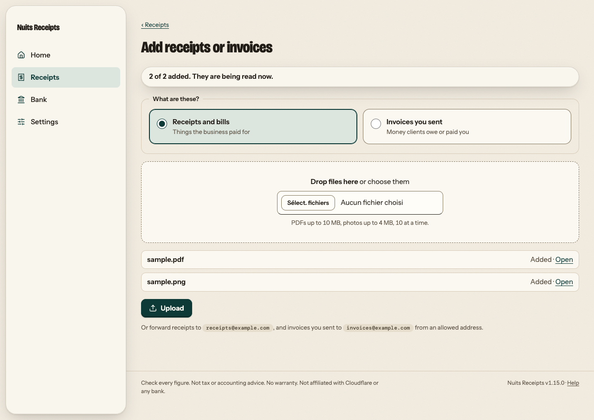
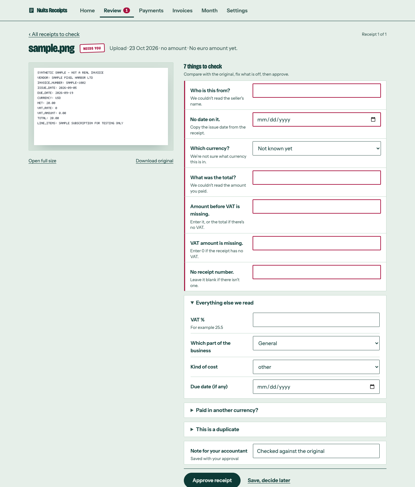
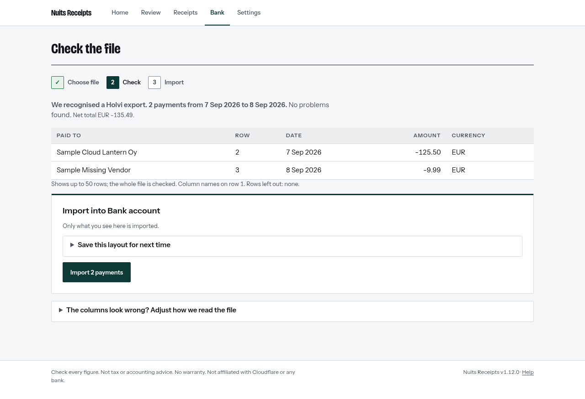
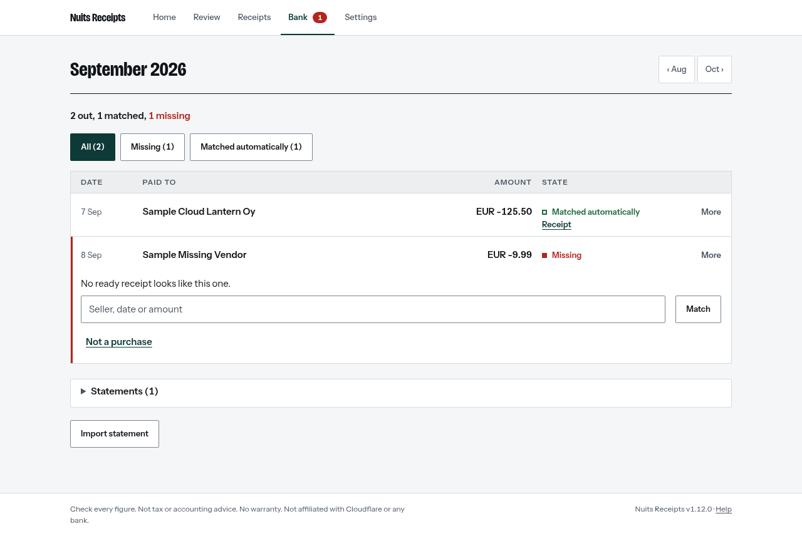
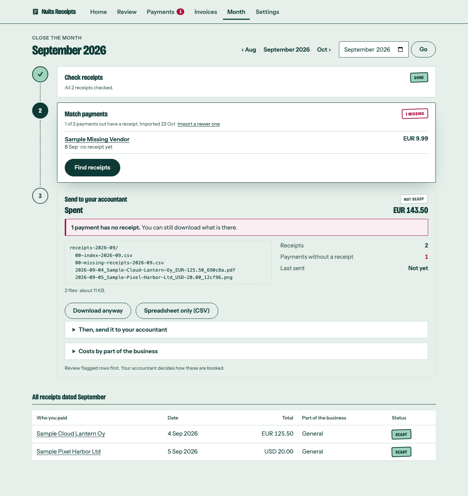

In this tutorial we take one month through Nuits Receipts from start to finish, using synthetic sample files. We upload two receipts, check and approve them, import a bank statement, see a payment matched to its receipt, download the month's ZIP and mark it as sent.

At the end, September 2026 in your copy shows **Sent**, and you have the ZIP your accountant would receive.

You need a copy of the app you can sign in to. If you do not have one yet, follow [Deploy your own copy](/tutorials/deploy-your-own-copy/) first.

## Get the sample files

The sample files are in the repository, in [`scripts/sample-receipts/`](https://github.com/bapspatil/nuits-receipts/tree/main/scripts/sample-receipts). Download these three to your computer:

- `sample.pdf`: a receipt from Sample Cloud Lantern Oy
- `sample.png`: a photo-style receipt from Sample Pixel Harbor Ltd
- `bank.csv`: a bank statement with two payments out

None of them is real financial data. Both receipts are dated September 2026, so that is the month we work on.

These are the values printed on the two receipts. We check the app's reading against them in a moment.

| Field | `sample.pdf` | `sample.png` |
| --- | --- | --- |
| Seller | Sample Cloud Lantern Oy | Sample Pixel Harbor Ltd |
| Receipt number | SAMPLE-1001 | SAMPLE-1002 |
| Date | 4 Sep 2026 | 5 Sep 2026 |
| Currency | EUR | USD |
| Before VAT | 100.00 | 20.00 |
| VAT % | 25.5 | 0 |
| VAT amount | 25.50 | 0.00 |
| Total | 125.50 | 20.00 |

## Upload the receipts

Sign in to your copy. **Home** opens on **Welcome**, with a short setup checklist above an upload form. You can finish the checklist later. Under the upload form, follow the **Add several** link. The **Add receipts or invoices** page opens.



1. Leave **Receipts and bills** selected.
2. Choose `sample.pdf` and `sample.png` together.
3. Press **Add files**.

Each file shows **Added** with an **Open** link, and the page says **2 of 2 added. They are being read now.**

## Check and approve each receipt

Open **Review** in the top bar (on a phone, the tab bar at the bottom). Its title says how many receipts the app wants you to check, for example **1 to check, 1 undated**. Each row shows the first question, such as **Seller +6**. Select the first one in the list.

The receipt page shows **The original** beside what the app read. Anything it is unsure of comes first, as a short question with its field, under a heading such as **7 to check**. The bar at the bottom says where you are, for example **1 of 1 to check**, and holds **Approve receipt**.



In this screenshot the app could not read anything from the photo, so every field is flagged. Your copy may have read more of it.

For each receipt in Review:

1. Compare every field with the table above. Fill in anything that is empty and correct anything that differs. Set **Which currency?** from the list. The fields that were not flagged are under **Other fields**.
2. Leave **Part** and **Kind** as they are.
3. Leave the **Note** as **Checked against the original**.
4. Press **Approve receipt**.

**Approve receipt** opens the next receipt in Review, with the banner **Approved.** After the last one, **Review** says **All checked** and points you to the next step: **Import statement**. For the USD receipt, **Other fields** shows a euro amount converted at the ECB reference rate.

:::note
If the app read a receipt correctly, it is already **Ready** and does not appear in Review. Open it from **Receipts** later if you want to compare it with the table anyway.
:::

## Import the bank statement

Press **Import statement** on **Review**, or open **Bank** in the top bar (on a phone, the tab bar at the bottom) and press **Import statement** there. The **Import a bank statement** page opens. Its three steps are **Choose file**, **Check** and **Import**.

1. Under **Bank statement (CSV file)**, choose `bank.csv`.
2. Leave **Which account is this?** set to **Bank account**.
3. Press **Check the file**.

The **Check the file** page shows what the app read before anything is saved. It recognises the sample's layout, says **No problems found.**, and lists two payments: Sample Cloud Lantern Oy for -125.50 and Sample Missing Vendor for -9.99.



Press **Import 2 payments**.

## See the match

The app takes you to **Bank** for September 2026, with **Added 2 payments. Paid out: 1 matched, 0 not a purchase, 1 missing.** at the top.



The page opens on **Missing**, under the line "2 out, 1 matched, 0 not a purchase, 1 missing". Sample Missing Vendor shows the **Missing** stamp and **No receipt fits.**, because none of your receipts fits it. Under **All**, the Sample Cloud Lantern Oy payment shows **Matched automatically** and a **Receipt** link: the app paired it with the PDF receipt by amount, date and name. When a receipt only nearly fits, the app shows it beside the payment as **Likely** and leaves the choice to you.

This sample payment has no receipt on purpose. Under it, press **Not a purchase**. It now shows **Not a purchase**, and the page says **Every payment has a receipt.**

## Send the month

On **Bank**, press **Send September**. **Home** for September 2026 opens, with three rows: **Check**, **Match** and **Send**.



**Check** says **All checked**, **Match** says **All matched** and **Send** shows **Ready**. Open **In the ZIP** to see the files:

```
receipts-2026-09/
  00-index-2026-09.csv
  2026-09-04_Sample-Cloud-Lantern-Oy_EUR-125.50_690c8a.pdf
  2026-09-05_Sample-Pixel-Harbor-Ltd_USD-20.00_12cf96.png
```

1. Press **Download ZIP**. Your browser saves `receipts-2026-09.zip`. Open it and you find the two originals and the index spreadsheet.
2. In real use, this is when you send the folder to your accountant.
3. Press **Mark September as sent**.

The page says **Marked September 2026 as sent.** and **Send** now reads **Sent** with today's date. If you want the CSV on its own, **CSV** sits beside the ZIP button.

## What we did

You put a whole month through Nuits Receipts: two receipts read and approved, a bank statement imported, one payment matched to its receipt, one marked as not needing one, and the month packaged and marked as sent. If a receipt dated September changes later, Home tells you and offers just the changed files.

From here, the [how-to guides](/how-to/) cover each part of the monthly routine with your own files, starting with [Add receipts](/how-to/add-receipts/) and [Import a bank CSV](/how-to/import-a-bank-csv/).
